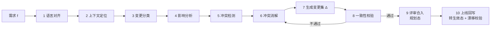

# DDD 驱动的系统知识库维护方法论

> 定位：讲方法论，只列关键环节和措施，不涉及具体实现方案。

---

## 0. 任务描述

| 项 | 内容 |
|---|---|
| **背景** | 现有一个复杂系统知识库（KB），里面有业务规则、服务实现、代码仓库、业务配置、开发 SOP 等内容。这些内容来源多、粒度不一，彼此之间的关系也没有写明 |
| **目标** | 借鉴 DDD，把知识库整理成两层：**业务规则层（领域模型）**和**实现层（服务 / 代码 / 配置）**，并且两层之间可以互相追溯 |
| **用途** | 作为 AI Agent 做需求分析、任务拆解等工作时的**唯一事实来源（Single Source of Truth）** |
| **范围** | ① 回顾 DDD 关键概念和设计原则；② 给出基于 DDD 的知识库组织与维护方法论；③ 给出增量变更方法论：已有自洽的 KB，加入需求 f 后，得到仍然自洽的 KB′ |
| **约束** | 只讲方法论，抓关键环节和措施；不写具体工具、存储、代码实现 |
| **产出** | 本 Markdown 文档 |

---

## 1. DDD 关键概念与设计原则回顾

### 1.1 战略设计：划清问题空间和边界

| 概念 | 定义 | 对知识库的启发 |
|---|---|---|
| **领域 / 子域** | 业务问题空间，按价值分为核心域、支撑域和通用域 | 知识库的一级划分依据，投入的维护精力按价值分配 |
| **通用语言**（Ubiquitous Language） | 业务方和技术方共用、在一个上下文内没有歧义的语言 | 知识库的术语表是根基，所有规则都用它来表述 |
| **限界上下文**（Bounded Context） | 模型和语言有效的边界；同一个词在不同上下文里可以有不同含义 | 知识组织的基本单元，同时也是 owner 归属的单元 |
| **上下文映射**（Context Map） | 上下文之间的关系模式：合作关系、共享内核、客户-供应方、遵奉者、防腐层（ACL）、开放主机服务/发布语言（OHS/PL）、各行其道 | 跨上下文规则怎样传递、谁服从谁，变更影响沿这些关系扩散 |

### 1.2 战术设计：在边界内表达模型

| 概念 | 定义 | 知识库中的对应物 |
|---|---|---|
| **实体** | 有唯一标识、有生命周期的对象 | 业务对象卡片（标识、状态、生命周期） |
| **值对象** | 没有标识、不可变、靠属性判等 | 枚举、度量、取值约束 |
| **聚合 / 聚合根** | 一致性边界，不变量在聚合内部强一致 | 规则的**归属单元**，不变量挂在聚合上 |
| **领域服务** | 不属于任何单个实体的领域行为 | 跨对象的计算规则、判定规则 |
| **领域事件** | 业务上发生过的重要事实 | 流程衔接点，也是跨上下文影响的载体 |
| **规约**（Specification） | 可组合、可判定的业务断言 | 规则的结构化表达方式 |
| **应用服务 / 仓储 / 工厂** | 编排、持久化、创建 | 实现层知识，不放进领域层 |

### 1.3 关键设计原则

1. **模型驱动**：模型、语言、代码保持同构，模型就是设计。
2. **边界优先**：先划上下文，再建模型；不追求一个大一统的全局模型。
3. **不变量守护**：聚合内部强一致，聚合之间最终一致（通过事件衔接）。
4. **高内聚、低耦合，依赖方向向内**：领域不依赖实现，实现依赖领域（分层架构 / 六边形架构 / 依赖倒置）。
5. **隐式概念显式化**：把散落在代码 if-else 和配置里的规则提炼成有名字的概念。
6. **知识消化（Knowledge Crunching）与持续重构**：模型随着理解加深而演进，目标是更深层的模型。
7. **防腐**：外部模型和遗留模型要经过翻译才能进入，不污染本上下文的语言。

---

## 2. 方法论一：用 DDD 组织和维护系统知识库

### 2.1 核心理念

> **知识库就是领域模型的显式载体。** 业务规则和实现分开存放，但要能互相追溯；每条事实只存一处，其他地方一律引用。

### 2.2 分层结构（依赖方向自上而下，下层不能反向定义上层）

| 层 | 内容 | 性质 |
|---|---|---|
| **L0 语言层** | 通用语言术语表（按上下文划分）、跨上下文术语映射 | 定义层，根基 |
| **L1 领域层**（业务事实） | 子域、上下文地图、聚合/实体/值对象、业务规则、领域事件、业务流程、策略 | **事实的权威来源**，不依赖具体实现 |
| **L2 映射层** | 规则 ↔ 服务/接口/配置项/代码模块 的追溯关系 | 两层之间的桥梁，用来做漂移检测 |
| **L3 实现层** | 服务、仓库、接口契约、配置、数据模型、开发 SOP | 对实现的描述，用来证明规则是怎样落地的 |
| **横切：决策记录** | ADR、变更日志、未决问题 | 回答"为什么是这样"，以及"还有什么不知道" |

> 原则：**规则只在 L1 定义，L3 只写怎样实现。** 代码和规则冲突时，不能默认代码就是对的，要先判定再回写。

### 2.3 知识单元元模型（统一"形状"）

每个知识单元至少带这些元数据：

- **唯一 ID**（可以被引用、被 Agent 引用溯源）
- **归属上下文 / 聚合**（单一归属）
- **类型**：术语 / 实体 / 规则 / 事件 / 流程 / 配置 / 服务 / SOP / 决策
- **状态**：草稿 → 评审中 → 生效 → 已废弃（另有**规划态**，见 3.4）
- **版本与生效时间**
- **Owner**（业务 owner、技术 owner）
- **证据来源**（PRD、代码位置、配置、会议结论）和**置信度**
- **关联**：依赖、被依赖、触发、冲突、替代

**业务规则**要写成可判定的结构，例如：适用上下文 + 前置条件 + 约束/计算 + 结果 + 例外 + **示例（正例/反例）**。

### 2.4 组织原则

| 原则 | 要点 |
|---|---|
| **按上下文切分** | 一级结构是子域和上下文，不按系统、团队或文档来源划分 |
| **一事一处** | 同一事实只存一处，其他地方引用，不复制 |
| **术语先行** | 新概念先进术语表再使用；同名不同义的概念必须标明所属上下文 |
| **规则原子化** | 一条规则只表达一个可判定的断言，便于检测冲突和追溯影响 |
| **显式边界** | 跨上下文的交互只通过上下文映射和领域事件表达 |
| **可追溯** | 生效的规则都应该能映射到实现，实现都应该能回溯到规则（暂时缺失的映射要显式标出来） |
| **缺口显式化** | 不知道的就标"未决 / 待确认"，不让 Agent 去猜 |

### 2.5 知识库级不变量（KB 的"一致性定义"）

可以把整个 KB 看成一个大聚合，它要始终满足以下不变量：

1. **术语唯一**：同一上下文内术语没有歧义，跨上下文的同名术语都有映射说明。
2. **引用完整**：没有悬空引用，没有孤立的关键单元。
3. **规则无矛盾**：同一适用条件下不存在结论冲突的生效规则；条件有重叠时，优先级要显式。
4. **归属唯一**：每个单元只有一个上下文、一个 owner。
5. **分层合规**：L1 不依赖 L3 的细节；规则不在实现层里重复定义。
6. **状态一致**：生效的规则不引用已废弃的单元；规划态不污染现行态。
7. **实现一致**：生效规则和映射到的实现没有漂移（或者漂移已被登记）。

### 2.6 建设与维护的关键环节

| 环节 | 关键措施 |
|---|---|
| ① **领域发现** | 正向：事件风暴、业务访谈；逆向：从代码、配置、SOP 中抽取隐式规则 |
| ② **边界划分** | 识别子域和上下文，画上下文地图，明确上下游和防腐层 |
| ③ **语言统一** | 建术语表，消除同义词和多义词，跨上下文建映射 |
| ④ **规则提炼** | 规则原子化、结构化，挂到聚合上，附示例和证据 |
| ⑤ **实现映射** | 建 L2 追溯关系，标注覆盖率和缺口 |
| ⑥ **一致性校验** | 按 2.5 的不变量做结构校验和语义校验 |
| ⑦ **发布与消费** | 为 Agent 提供入口索引（上下文地图 → 上下文 → 聚合 → 规则），支持逐层加载和按 ID 引用 |
| ⑧ **治理演进** | owner 评审、新鲜度巡检、漂移检测、定期重构（合并、拆分上下文，提炼更深层的概念） |

### 2.7 面向 AI Agent 的消费约定

- **唯一入口**：Agent 从上下文地图进入，按"上下文 → 聚合 → 规则 → 实现"逐层深入。
- **只信生效态**：做现状分析只用"生效"知识；规划态、草稿要明确标注。
- **回答必须带出处**：结论要引用知识单元 ID，可追溯、可核验。
- **遇到缺口就上报**：命中"未决"或找不到相关知识时，输出待确认问题，不要自行补全。

---

## 3. 方法论二：增量变更下的知识库正确性维护

### 3.1 问题形式化

- 已知：`KB` 满足不变量集合 `Inv`（逻辑自洽）。
- 输入：需求 `f`。
- 求变更集 `Δ`，使 `KB′ = apply(KB, Δ)` 满足：
  1. **一致性**：`Inv(KB′)` 成立；
  2. **充分性**：`KB′` 完整表达了 `f` 的意图；
  3. **最小性**：`Δ` 只包含必要的改动，不顺带改动无关知识；
  4. **可追溯**：每项改动都能追溯到 `f` 和决策依据。

> 理论参照：信念修正（AGM）的三种操作——**扩张**（新增，不冲突）、**修正**（新增并替换冲突项）、**收缩**（删除），再加上 DDD 的**重构**（边界调整）。

### 3.2 变更流程（10 步）

| 步骤 | 目的 | 关键措施 |
|---|---|---|
| **1 语言对齐** | 把需求转成通用语言表述 | 把需求里的词映射到术语表；识别新术语、同义词、歧义词；无法对齐的词作为澄清问题 |
| **2 上下文定位** | 确定 f 落在哪里 | 定位到子域 → 上下文 → 聚合；涉及多个上下文时，识别主上下文和受影响的上下文 |
| **3 变更分类** | 决定处理策略 | 按扩张、修正、收缩、重构分类；重构类（边界变动）提高评审级别 |
| **4 影响分析** | 求出影响集 Impact(f) | 沿关联图扩散：同聚合规则 → 依赖规则 → 事件订阅方 → 上下文映射的下游 → L2 映射 → L3 实现和 SOP |
| **5 冲突检测** | 找出所有会破坏一致性的点 | 检查：直接矛盾、条件重叠且优先级不明、术语语义漂移、不变量被破坏、跨上下文不一致、冗余或重复定义 |
| **6 冲突消解** | 逐项给出消解决策 | 策略包括：**替代**（旧规则废弃并留痕）、**细化**（按条件分区、加例外）、**显式优先级**、**上下文隔离**（拆上下文或加防腐层）、**上报**（交业务 owner 裁决）；每个决策都记录 ADR |
| **7 生成变更集 Δ** | 形成原子、最小的变更单元 | Δ = L0/L1/L2/L3 各层的增、删、改，加上待实现项和未决问题；按"先 L0 → 后 L1 → 再 L2/L3"的依赖顺序排列 |
| **8 一致性校验** | 证明 Inv(KB′) 成立 | 结构校验（引用、分层、归属）+ 语义校验（规则冲突）+ **示例回归**（已有规则的示例在 KB′ 下仍然成立）+ f 的验收示例在 KB′ 下成立 |
| **9 评审合入** | 业务正确性把关 | 按影响面分级评审（单个聚合 / 跨聚合 / 跨上下文）；合入后状态为**规划态**，和现行态隔离 |
| **10 上线回写** | 闭环，转为事实 | 上线后切换为生效态（带生效时间）；按 L2 映射核对实现与规则，有漂移就登记并修正 |

### 3.3 冲突类型与消解策略速查

| 冲突类型 | 表现 | 推荐策略 |
|---|---|---|
| 直接矛盾 | 同一条件下结论相反 | 替代（废弃旧规则）或上报 |
| 条件重叠 | 两条规则适用范围有交集，结论不同 | 细化条件分区，或者显式写明优先级 |
| 术语漂移 | f 里的词和 KB 里的同名术语含义不同 | 重命名或新建术语；必要时拆分上下文 |
| 不变量破坏 | f 违反了聚合的不变量 | 重新审视聚合边界，或者调整不变量（升级评审） |
| 跨上下文不一致 | 上游变了，下游的假设失效 | 按映射模式处理：下游是遵奉者就跟着改；有防腐层就只改翻译层 |
| 冗余 | f 的规则已经存在或可以推导出来 | 改为引用已有规则，不新增 |

### 3.4 关键保障措施

1. **双态隔离（规划态 / 生效态）**：未上线的需求规则不能当成现状事实，避免 Agent 把"将要怎样"误当成"现在怎样"。
2. **规则即用例**：每条规则附带正例和反例，这些示例构成 KB 的回归测试集，每次变更都要回放。
3. **变更即事件**：每次变更记为一条带 f 编号、Δ、决策和时间的变更事件，支持追溯、审计和回滚。
4. **单一写入方**：每个知识单元只由所属上下文的 owner 批准修改；跨上下文的改动要上下游双方确认。
5. **并发需求隔离**：多个需求并行时各自隔离 Δ，合并时对 Δ₁ ∪ Δ₂ **重新做冲突检测**，因为两个各自自洽的变更合在一起不一定自洽。
6. **不确定性不进入生效态**：存在未决问题的规则停留在草稿或规划态，并显式列出待确认项。
7. **按影响面分级评审**：评审强度跟影响半径和变更类型挂钩；重构类和跨上下文类必须人工裁决。
8. **持续防漂移**：定期对照实现和规则；生产中的规则变更（比如改配置）也要反向走一遍本流程。

### 3.5 正确性的分层保障

| 层次 | 要回答的问题 | 主要手段 | 自动化程度 |
|---|---|---|---|
| 结构正确 | 格式、引用、分层、归属是否合规 | 元模型 schema 校验、引用检查 | 高 |
| 语义一致 | 规则之间有没有矛盾 | 冲突检测、示例回归 | 中（Agent 辅助 + 人工确认） |
| 业务正确 | 是否符合业务真实意图 | owner 评审、验收示例 | 低（以人为主） |
| 实现一致 | 规则和代码、配置是否一致 | L2 映射核对、漂移检测 | 中 |

### 3.6 反模式

- 只改实现、不改规则（或者只改规则、不回写实现），两层逐渐脱节。
- 直接追加新规则而不废弃旧规则，KB 里同时存在新旧两种说法。
- 把需求文档原文复制进 KB，没有经过语言对齐和原子化。
- 跨上下文直接引用对方内部概念，绕过上下文映射。
- 需求还没上线就直接标记为生效，让 Agent 拿到的事实被污染。
- 冲突靠"默认最新的优先"隐式解决，没有留下决策记录。

---

## 附：一句话总结

> **以限界上下文划分边界，以通用语言统一表述，以聚合守护规则不变量，以映射层连接规则和实现；每次需求变更都走"对齐 → 定位 → 影响分析 → 冲突消解 → 校验 → 双态合入 → 上线回写"的闭环，保证 KB 始终是 Agent 可信的唯一事实来源。**
