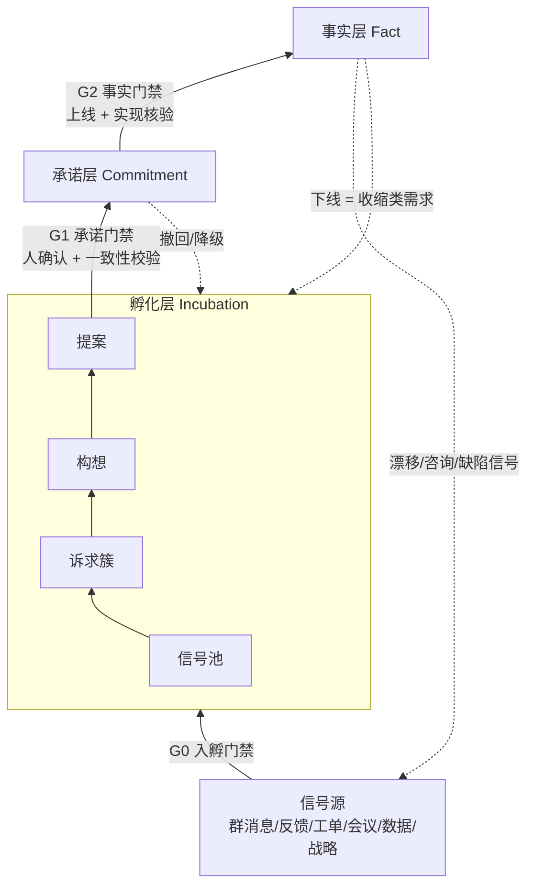

# 知识库三层成熟度模型与需求孵化方法论

> 与《DDD驱动的系统知识库维护方法论》配套使用：
> - 那一篇解决**结构**问题：知识按领域怎么组织（L0 语言 / L1 领域 / L2 映射 / L3 实现），以及单次变更怎样保持一致；
> - 本篇解决**状态**问题：知识按确定性怎么分层，需求从哪里来，又怎样一步步落到线上。
>
> 定位：讲方法论，只列关键环节和措施，不涉及具体实现。

---

## 0. 任务描述

| 项 | 内容 |
|---|---|
| **背景** | 系统知识库里同时存在三类知识：已经上线的事实、已经确认要做的需求、尚未确认的想法和愿景。三者混在一起时，Agent 容易把"将来要做的"或"有人提过的"当成"现在就是这样的" |
| **目标** | 按确定性把知识库分成三层，每层定义一致性要求、写入权限和晋升门禁；在此基础上建立一条从信号（群消息、用户反馈等）自动孵化需求的流水线 |
| **用途** | AI Agent 做现状分析、需求分析、任务拆解时，按任务类型选用对应的知识视图；同时作为需求的统一入口 |
| **产出** | 本 Markdown 文档 |

---

## 1. 核心思想

1. **按确定性分层**：越往下越确定、越稳定，一致性要求也越严；越往上越开放、变化越快，允许有矛盾。
2. **需求就是知识向下沉降**：一条想法从孵化层出发，经确认进入承诺层，上线后沉淀为事实层。需求管理和知识库维护是同一个过程。
3. **依赖只能向下**：上层可以引用下层，下层不能依赖上层。这和 DDD 中领域不依赖实现的依赖规则是同一个思路。
4. **承诺层存变更，不存副本**：承诺层记录的是对事实层的补丁（新增、修改、废弃），而不是复制一份改过的全量。
5. **权限逐层收紧**：Agent 可以自主写孵化层，可以起草承诺层，但不能直接写事实层。
6. **自动形成需求不等于自动承诺需求**：从信号到提案可以全自动，进入承诺层必须经过人确认。

---

## 2. 三层模型

### 2.1 各层定义

| | **事实层 Fact（As-Is）** | **承诺层 Commitment（To-Be）** | **孵化层 Incubation（Could-Be）** |
|---|---|---|---|
| **含义** | 已实现并上线的特性 | 已与现有知识库对齐、已获确认、待交付的变更 | 未对齐、未确认的想法、诉求、愿景 |
| **内容** | 生效的术语、规则、流程、实现映射、配置、SOP | 需求变更集 Δ（规则的增、改、废弃）、验收示例、目标版本、实现设计 | 原始信号、诉求簇、构想、提案草稿、长期愿景 |
| **一致性要求** | **最强**：自身自洽，且与线上实现一致 | **强**：事实层叠加承诺层后自洽 | **弱**：允许互相矛盾，但必须标出与下层的关系 |
| **证据来源** | 线上实现、发布记录、核验结果 | 用户或业务 owner 的确认、评审结论、决策记录（ADR） | 群消息、反馈、工单、会议、数据、战略规划 |
| **写入方** | 上线事件驱动晋升；人确认的校准 | Agent 起草，人确认后写入 | Agent 自主写入 |
| **变化频率** | 低，按版本 | 中，按迭代 | 高，实时 |
| **能否作为事实引用** | 能 | 只能作为"计划"引用 | 不能，只能作为"线索"引用 |

### 2.2 三种视图

记 F 为事实层，C 为承诺层，I 为孵化层：

| 视图 | 组成 | 回答的问题 |
|---|---|---|
| **现状视图** | F | 系统现在是什么样子 |
| **未来视图** | F ⊕ C | 系统将会是什么样子；可以按版本切片：F ⊕ C(≤R)，表示版本 R 上线后的样子 |
| **探索视图** | F ⊕ C ＋ I（I 标注为假设） | 系统可能会变成什么样子，以及有哪些诉求还没有被满足 |

> ⊕ 不是简单相加，而是把承诺层的补丁按交付顺序依次应用到事实层。补丁可能修改甚至废弃事实层中的规则。

**推论**：承诺层减去事实层，也就是 C 相对于 F 的差异，正好是待开发的工作清单。任务拆解的本质就是把这个差异分解到实现层。

### 2.3 与 DDD 结构层正交

成熟度分层（纵向）和 DDD 结构分层（横向）构成一个矩阵，每个知识单元都同时属于某个成熟度层和某个结构层：

| | L0 语言 | L1 领域规则 | L2 映射 | L3 实现 |
|---|---|---|---|---|
| **事实层** | 完整 | 完整 | 完整（可核验） | 完整 |
| **承诺层** | 新增或变更的术语 | 规则 Δ + 验收示例 | 计划中的映射 | 设计方案、改动点 |
| **孵化层** | 候选术语（可能有歧义） | 问题陈述、规则草图 | 通常没有 | 通常没有 |

越往上，越集中在问题空间（L0/L1）；越往下，越完整地延伸到解空间（L2/L3）。

### 2.4 跨层不变量

1. **依赖向下**：事实层不引用承诺层和孵化层；承诺层不引用孵化层，只记录来源追溯。
2. **单一归属**：一个知识单元在同一时刻只属于一层。晋升是移动，不是复制。
3. **补丁表达**：承诺层修改事实层时，用"引用 + 变更类型（新增 / 修改 / 废弃）"来表达，不复制原文再改。
4. **基线锚定**：每个承诺项都记录它所基于的事实层版本。
5. **切片一致**：对每个目标版本 R，F ⊕ C(≤R) 都要自洽，而不只是最终状态自洽。
6. **关系显式**：每个孵化项都要标出与 F 和 C 的关系：新增、扩展、修改、冲突或重复。

---

## 3. 知识流转：晋升、降级、退出



### 3.1 晋升门禁

| 门禁 | 方向 | 准入条件 | 决策者 |
|---|---|---|---|
| **G0 入孵** | 信号 → 孵化层 | 来源可追溯；能识别出诉求；已经分诊（排除缺陷和咨询类，见 4.3）；已去重或归并 | Agent 自动 |
| **G1 承诺** | 孵化层 → 承诺层 | ① 用户或业务 owner **明确确认**；② 语言已对齐、上下文已定位；③ 规则已原子化，并附验收示例；④ **F ⊕ C ⊕ Δ 通过一致性校验**（执行配套文档中的十步变更流程第 1–8 步）；⑤ 没有阻塞性的未决问题；⑥ 指定了 owner 和目标版本 | 人裁决，Agent 准备材料 |
| **G2 事实** | 承诺层 → 事实层 | ① 已上线（有发布记录）；② 实现映射已建立；③ 验收示例在实现上成立；④ 写入生效时间 | 发布事件触发，Agent 核验，异常时由人处理 |

### 3.2 逆向与退出路径

| 场景 | 处理 |
|---|---|
| **孵化项休眠** | 长期没有新证据时权重衰减，进入休眠；出现新信号时唤醒 |
| **孵化项否决** | 记录否决理由，作为反证保留；同类诉求再次出现时自动关联，避免反复讨论 |
| **承诺项撤回或降级** | 从未来视图中移除它的 Δ，**重新校验依赖它的其他承诺项**，然后退回孵化层或归档 |
| **承诺项变更** | 视为一次新的 G1：重新做影响分析和一致性校验 |
| **事实下线** | 不能直接删除，要以"收缩类需求"重新走孵化 → 承诺 → 上线流程 |
| **事实漂移** | 发现知识库与线上不一致时，先判定哪一方符合预期：知识库正确就转缺陷；线上正确就校准事实层（需人确认并留痕） |

### 3.3 基线与 Rebase

- 每个承诺项都是**基于某个事实层版本的分支**。
- 任何一个承诺项上线后（事实层变化），其余承诺项都要**以新事实层为基准重新校验（rebase）**：检查它的前置假设是否仍然成立、是否产生新的冲突。
- 多个承诺项并行时，按交付顺序逐版本切片校验（不变量 5）。两个各自自洽的承诺项合在一起不一定自洽。

---

## 4. 需求孵化方法论

### 4.1 双向来源

| 方向 | 来源 | 特点 | 进入方式 |
|---|---|---|---|
| **自下而上** | 群消息、用户反馈、工单、客服记录、会议纪要、线上数据（报错、行为、埋点） | 量大、零散、隐式，多为问题描述 | 信号 → 分诊 → 归并 → 诉求簇 |
| **自上而下** | 战略、OKR、产品愿景、竞品、合规要求 | 量少、抽象、方向性强 | 愿景 → 目标 → **能力缺口（与 F ⊕ C 对比）** → 构想 |

两个方向在孵化层汇合：愿景为自下而上的诉求提供**优先级锚点**，诉求为愿景提供**证据支撑**。

### 4.2 孵化流水线

| 阶段 | 目的 | 关键措施 |
|---|---|---|
| **① 采集** | 持续获取信号 | 只接入已授权的来源；最小化采集并脱敏；**保留原文和出处**作为证据，原文不可修改 |
| **② 分诊** | 判断信号的性质和去向 | **对照 F 和 C 判断**（见 4.3），一个入口对应四种去向 |
| **③ 提炼** | 把信号转成结构化诉求 | 抽取角色、场景、痛点、期望、频次、影响；**区分问题和方案**：用户提出的方案只作参考，要还原背后的真实问题 |
| **④ 归并** | 形成诉求簇，累积证据 | 语义去重，合并同类；证据持续累积到诉求簇上；关联已否决或休眠的同类项 |
| **⑤ 框定** | 放进领域坐标系 | 用通用语言重述；定位到子域、上下文、聚合；**标出与 F 和 C 的关系**（新增 / 扩展 / 修改 / 冲突 / 重复） |
| **⑥ 评估** | 决定是否值得推进 | 综合价值、紧迫度、成本、风险、战略契合度，**并预检冲突**（提前暴露和现有规则的冲突） |
| **⑦ 成形** | 产出可供确认的提案 | 提案包括：问题陈述、目标、范围和非范围、规则草案（Δ）、验收示例、影响面、未决问题、证据链 |
| **⑧ 确认** | 进入承诺层 | 推送给用户或业务 owner 确认，通过 G1 门禁；结论无论通过、否决还是补充信息都要回写 |

> ①–⑦ 可以由 Agent 全自动完成，产出物停在孵化层；⑧ 必须由人参与。

### 4.3 分诊：一个入口，四种去向

收到一条反馈，例如"系统不支持 X"时，先查知识库再决定去向：

| 对照结果 | 判定 | 去向 |
|---|---|---|
| 事实层显示**支持**，实现也一致 | 使用问题或文档问题 | **知识补全**：优化事实层的表述，或补 FAQ；同时说明知识库的可读性存在缺口 |
| 事实层显示支持，但**线上实现不符** | 缺陷或漂移 | **转缺陷**，或校准事实层（见 3.2） |
| 事实层不支持，**承诺层已有** | 已规划 | **关联到已有承诺项**，累积证据，告知反馈者计划 |
| 事实层和承诺层**都没有** | 新诉求 | **进入孵化层**（新建或归并到已有诉求簇） |

分诊让同一条信号流同时服务两件事：**需求孵化**和**知识库自我纠错**。

### 4.4 孵化项生命周期

```
信号 ──► 诉求簇 ──► 构想 ──► 提案 ──[G1]──► 已承诺
  │         │         │        │
  └─────────┴─────────┴────────┴──► 休眠 / 否决 / 合并 / 转缺陷 / 转知识补全
```

每次状态变化都要留痕：谁、何时、依据什么。

### 4.5 证据与优先级

- **证据维度**：频次（多少次）、广度（多少用户、群、客户）、强度（是否阻塞业务、情绪强弱）、价值（客户或场景的重要度）、契合度（与愿景和战略是否一致）。
- **时间衰减**：证据随时间降权，避免陈旧诉求长期占据前列。
- **防偏差**：
  - 区分声量和价值，不让最活跃的群主导优先级；
  - 单一来源的诉求要寻求交叉验证；
  - 已否决的诉求要有新证据才能重新进入评估。
- **推进阈值**：证据权重达到阈值才进入成形阶段，避免孵化层被大量低价值提案淹没。

---

## 5. 分层维护方法论

| 层 | 维护重点 | 关键措施 |
|---|---|---|
| **事实层** | 真实、新鲜 | 上线事件驱动晋升（不靠人工记得更新）；定期对照实现检测漂移；新鲜度巡检；示例回归 |
| **承诺层** | 一致、可交付 | G1 一致性校验；事实层每次变化后做 rebase；版本切片校验；滞留治理（长期未推进的承诺项要复核：继续、调整还是撤回） |
| **孵化层** | 有序、不堆积 | 持续去重归并；休眠衰减；否决留痕；定期清理；与愿景对齐复盘 |

### 运行节奏

| 节奏 | 动作 |
|---|---|
| **实时** | 信号采集、分诊、归并 |
| **每日** | 诉求簇更新、证据权重重算、提案草稿生成 |
| **每周或每迭代** | G1 评审会：集中确认或否决提案；承诺项滞留检查 |
| **每次发布** | G2 晋升；对剩余承诺项做 rebase；把结果回告原始反馈者 |
| **定期（月或季度）** | 事实层漂移巡检；孵化层清理；愿景与诉求对齐复盘；度量回顾 |

---

## 6. 人机分工与权限

| 层 | Agent 权限 | 人的职责 |
|---|---|---|
| **孵化层** | 读写：采集、分诊、提炼、归并、框定、评估、成形 | 抽查质量；设定愿景和优先级规则；否决 |
| **承诺层** | 起草、校验、做影响分析和 rebase；**不能自行写入** | **确认**（G1）；冲突裁决；边界重构决策 |
| **事实层** | 核验、检测漂移、提出校准建议；**不能自行写入** | 确认校准；处理异常；晋升由发布事件驱动 |

> 原则：**越接近事实，人的把关越重；越接近信号，Agent 的自动化程度越高。**

---

## 7. Agent 消费约定

| 任务 | 使用视图 | 约定 |
|---|---|---|
| 现状问答、排障、影响评估 | 现状视图 F | 只引用事实层 |
| 需求分析 | 基线用未来视图 F ⊕ C，再加孵化层作参考 | 新需求要和 F ⊕ C 做一致性比对；关联孵化层中的相关诉求和否决记录 |
| 任务拆解 | 承诺项 Δ 相对于 F 的差异 | 把差异映射到 L2/L3，得到开发任务 |
| 规划、路线图 | 探索视图 | 孵化层内容必须标注为"未确认" |
| 通用 | — | 引用时注明层级和 ID；遇到冲突或缺口就上报，不自行补全 |

---

## 8. 闭环与度量

**闭环**：信号 → 需求 → 上线 → **回告反馈者** → **验证诉求是否解决（同类信号是否消失）**。

| 层 | 健康度指标 |
|---|---|
| 事实层 | 实现一致率、新鲜度、映射覆盖率 |
| 承诺层 | G1 一次通过率、rebase 冲突数、平均滞留时长、撤回率 |
| 孵化层 | 信号转化率、平均孵化周期、重复提出率、否决原因分布、积压量 |
| 端到端 | 反馈闭环率、上线后同类信号下降幅度、知识补全类信号占比（反映知识库可读性） |

---

## 9. 反模式

- Agent 把孵化层内容当作事实引用，导致幻觉被放大。
- 承诺层全量复制事实层后再改，两份内容逐渐分叉。
- 承诺项上线后没有晋升，事实层长期滞后于线上。
- 自动生成的需求跳过用户确认，直接进入承诺层。
- 把用户提出的方案当成需求，忽略背后的真实问题。
- 孵化层只进不出，变成垃圾场。
- 承诺项撤回后，没有清理依赖它的其他承诺项。
- 某个需求上线后，其余承诺项没有做 rebase，仍然基于过时的事实做假设。
- 缺陷、咨询类信号被当成新需求，事实层的错误被掩盖。

---

## 附：一句话总结

> **按确定性把知识库分成三层：孵化层（可能）、承诺层（将会）、事实层（现在）。一致性逐层加强，权限逐层收紧。需求是知识经过 G0、G1、G2 三道门禁向下沉降的过程。信号经分诊后同时驱动需求孵化和知识库纠错。事实层叠加承诺层就是系统的未来，两者的差异就是待开发的工作。**
