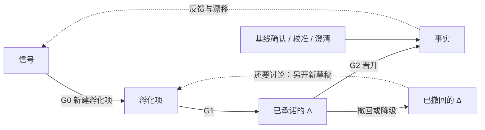

# 知识库成熟度模型

> 本篇定义知识的状态、视图、迁移门禁与权限。知识的组织方式见[知识库组织与维护](knowledge-organization.md)，操作步骤见[需求变更流程](change-workflow.md)。
> 门禁条件以本篇为准，流程篇引用条件，不另行维护一套准入标准。

## 1. 为什么要区分成熟度

系统知识库里同时存在已上线的事实、已确认待交付的需求、未确认的想法。混在一起时，Agent 容易把“有人提过”或“将来要做”当成“现在就是这样”。

本模型按确定性与交付状态区分三类内容：越接近事实，一致性要求越严格，写入权限越收紧。

- 未确认的想法允许矛盾，但必须保留来源并标明与现状和计划的关系。
- 已承诺的内容是对事实的变更，不复制一份全量未来知识库。
- 上线并核验后，应用变更更新生效知识，保留历史与追溯。
- **自动形成提案不等于自动承诺需求。** Agent 可以自主写孵化内容，业务承诺须人确认。

## 2. I/C/F 三层定义

| | **孵化层 I：Could-Be** | **承诺层 C：To-Be** | **事实层 F：As-Is** |
|---|---|---|---|
| 含义 | 未对齐、未确认的诉求与提案。愿景先拆成诉求再进入，本身不存放在这一层 | 已对齐、已确认、待交付的变更 | 已确认并且已经生效的现行事实 |
| 内容 | 孵化项本身。G0 通过时的内容是诉求簇，提交确认前的内容是提案草稿，并附证据。愿景是信号来源，不是这里的一种对象 | 变更集 Δ、验收示例、目标版本、实现设计 | 生效的术语、规则、流程、实现映射、配置、SOP |
| 一致性要求 | 弱。允许互相矛盾，但每项必须标明与 F/C 的变更关系 | 强。叠到事实上之后，每个交付检查点都自洽 | 最强。满足事实层知识不变量；与适用边界内的线上行为一致，或漂移已登记并进入处理 |
| 证据 | 群消息、反馈、工单、会议、数据、战略 | 诉求确认、上下文 owner 的批准、评审结论、ADR | 线上实现、发布记录、核验结果 |
| 写入方 | Agent 自主写入 | Agent 起草，人确认后写入 | 发布事件驱动晋升；上下文 owner 确认校准和澄清 |
| 变化频率 | 高，随信号变化 | 中，随迭代变化 | 按生效版本变化 |
| 可怎样引用 | 线索或假设，不是事实 | 计划，不是现状 | 当前事实 |

[知识单元](knowledge-organization.md#knowledge-unit)和[变更集](change-workflow.md#change-set)不是同一种对象：F 维护生效知识的当前版本，C 维护尚未交付的 Δ，I 保留尚未承诺的提案与证据。

事实层记录的是**已经生效的现行事实**，不是未交付的愿望，也不是未经核对的代码现场。现行事实应当与该基线适用边界内已核验的线上行为一致。二者不一致，或事实层内部互相矛盾时，按[事实漂移](#exceptions)和校准处理，不能一边口头维持文档、一边默认代码才算数。

## 3. 视图与结构的关系

### 3.1 视图

| 视图 | 组成 | 回答的问题 |
|---|---|---|
| 现状视图 | 当前基线适用边界内的 F | 已经生效的现行事实是什么 |
| 未来视图 | F ⊕ C | 已承诺变更按序交付后将是什么 |
| 探索视图 | 未来视图 ＋ 草稿、评审中和休眠的孵化项 | 还有哪些未确认的可能和诉求 |
| 候选视图 | 把尚未承诺的 Δ 插到拟定检查点后的试算 | 这次若承诺，从该检查点到序列末尾是否仍自洽 |

对外引用只有前三种。候选视图只用于承诺前的校验：其中的 Δ 仍是未承诺假设，试算结果不写入 C 或 F。基线尚未确认时，没有现状视图，整理稿不能当作 F 回答现状问题。探索视图里的 I 只并列草稿、评审中和休眠；已否决项作为反证另行查阅，已转承诺和已合并不在这里重复出现。

两个符号含义不同：

- **⊕** 按交付顺序把补丁应用到知识上。补丁可以新增、修改或废弃。结果必须满足该视图对应的知识不变量。
- **＋** 只把孵化项并列展示，不把它们应用成补丁，也不要求与 F/C 合成之后自洽。

同一目标版本内部的先后必须写明。比较时用带顺序的**交付检查点**，不能只凭版本号的大小。`C(≤p)` 包含检查点 p 上的那条承诺，以及所有更早的未交付承诺。`F ⊕ C(≤p)` 是这些承诺按序应用到 F 之后的结果。`F ⊕ C` 是最后一个检查点上的未来视图。

记法 `F ⊕ C ⊕ Δ` 专指 G1 前的候选视图：Δ 此时还不属于 C，先把它插到拟定检查点，再对从该点到序列末尾的每个检查点做 ⊕。它不是把三堆材料做无序合并。

承诺层已经表达相对于事实基线的变化。任务拆解处理 C 中**尚未交付的 Δ**，把它们映射到实现层，不再计算 `C − F`。

### 3.2 与 L0–L3 正交

[L0–L3](knowledge-organization.md#structure-layers)回答内容属于哪类知识；成熟度回答这份内容处于什么状态、可以怎样使用。

| | L0 语言 | L1 领域 | L2 映射 | L3 实现 |
|---|---|---|---|---|
| 孵化层 | 候选术语 | 问题陈述、规则草图 | 通常没有 | 通常没有 |
| 承诺层 | 术语变更 | 规则 Δ 与验收示例 | 计划映射 | 设计方案、改动点 |
| 事实层 | 生效术语 | 生效规则与流程 | 已核验映射 | 生效实现描述 |

越接近事实，越需要从问题空间延伸到解空间并补齐映射。该矩阵描述不同状态下的内容形态，不表示把同一个知识单元复制三份；变更集可以跨多个结构层。

### 3.3 跨层不变量

1. **依赖向下**：F 的有效性不依赖 C/I 的未交付或未确认内容；C 不以 I 为已确认前提。来源追溯与内容依赖要区分。
2. **区分知识与变更**：F 保存生效知识版本，C 保存待交付 Δ。G2 通过后应用 Δ 更新 F，已交付变更退出待交付集合，保留变更记录与历史版本。
3. **补丁表达**：新增、修改、废弃均注明作用对象与变更内容，不复制全量原文后另行维护。
4. **基线锚定**：每个承诺项记录基于哪个事实版本。
5. **检查点一致**：每个交付检查点 p 对应的 `F ⊕ C(≤p)` 都自洽，不只最终结果自洽。
6. **关系显式**：每个孵化项对每一条相关的已有断言标明一种变更关系。没有关系标记的孵化项不能进入 G1。

变更关系只有这六种：

| 关系 | 含义 |
|---|---|
| 新增 | F 与 C 中都没有对应断言 |
| 扩展 | 已有条件下的结论不变，只增加新的条件或结果 |
| 修改 | 某些已经成立的条件下，结论将改变 |
| 废弃 | 移除已有断言，且不用本次的新断言在原条件下替换它 |
| 冲突 | 与 F 或 C 对立，消解方式还没选定 |
| 重复 | 现有知识已经表达该诉求 |

孵化层允许矛盾，矛盾必须标成冲突、修改或重复，不能没有标记。承诺视图里不能留下未消解的冲突。

进入变更集的操作只有新增、修改、废弃。扩展落实为不改变原有结论的新增或修改；冲突先消解成上述操作之一；重复不产生变更集，只保留引用。

### 3.4 版本

三种版本各有所指，不能互相代替：

| 名称 | 指什么 |
|---|---|
| 知识版本 | 同一个知识单元 ID 的内容版本。修改产生新版本；现状视图只引用当前版本 |
| 事实基线版本 | 整个 F 的版本。基线确认、晋升、校准、澄清、以及回滚后的事实重建，都会使它前进 |
| 目标交付版本 | 承诺项计划交付的分组。组内先后由交付检查点决定，不按编号或日历的直观大小猜测 |

每个承诺项锚定它所基于的事实基线版本。知识单元仍记录自己的知识版本；基线版本不取代单元版本。

**基线适用边界**声明这一个 F 描述哪条产品线、哪类环境。规则上的前置条件只在该边界内部区分情形。部分对象已经生效时，把生效范围写进适用条件；范围扩大是一次新的事实写入，上一个知识版本保留。未写明的边界，不默认覆盖所有产品、环境和对象。

## 4. 状态迁移与门禁

基线确认建立第一个 F，不经过 G0。校准和澄清写入已经存在的 F，不把内容退回孵化。撤回或降级把原变更集标为已撤回；还要继续讨论时另开一条新的孵化草稿，不把同一份变更集改回候选。基线确认、校准、澄清和撤回都不另设成熟度层。图中的侧向入口就是这三条事实写入，不是第四个成熟度。

### 4.1 晋升条件

| 门禁 | 方向 | 必须满足的条件 | 决策者 |
|---|---|---|---|
| **G0 入孵** | 信号 → 新的孵化项 | 来源可追溯；能识别诉求；[分诊](change-workflow.md#triage)判定为新诉求；与已有 I/C 去重后仍需要独立孵化项 | Agent 自动 |
| **G1 承诺** | I → C | ① 诉求方或业务负责人确认问题与目标，且每个受影响上下文的 owner 批准相应知识变更；② 语言对齐、上下文定位；③ 规则原子化并附验收示例；④ 候选视图 `F ⊕ C ⊕ Δ` 从拟定检查点到序列末尾的每个交付检查点都通过[一致性校验](change-workflow.md#change-analysis)；⑤ 无阻塞性未决问题；⑥ 写明维护人、上下文 owner 和目标交付版本（含同一版本内的顺序） | 人裁决，Agent 准备材料 |
| **G2 事实** | C → F | ① 在基线适用边界内已经对使用者生效，并有发布记录；代码合并或制品产生本身不算生效；② 本次变更的实现映射已经建立，暂时无法追溯的部分显式登记为缺口；③ 本次验收示例在已生效的实现上成立，且不引入新的未登记漂移；④ 写入生效时间，知识版本与事实基线版本前进 | 发布事件触发，Agent 核验，异常由人处理 |

**基线确认**是事实层的起点，不是第四个成熟度，也不是 G2。它按上下文进行：该上下文尚未成为事实时，由其 owner 确认整理结果就是现行事实；缺口和已发现的漂移显式登记；已覆盖部分满足事实层强制的知识不变量。未确认的上下文不进入现状视图，只作为显式缺口。跨上下文契约在两侧都确认前，不写成事实。增量交付同样如此：契约两侧都已在各自适用边界内生效并核验，才把新契约写入事实；只完成一侧时，新契约留在承诺层，已生效一侧的实现映射登记为部分覆盖。Agent 可以起草整理稿，不能自行宣布为事实。

G0 不接收咨询、缺陷、校准、已规划、归并和待核验。归并进已有孵化项时不新开一项，也不再走一次 G0。

阻塞性未决问题，指存在一种合理解答会改变断言、适用条件、归属上下文或受影响上下文。上下文 owner 之间尚未达成的批准，也是阻塞。只影响实现细节、且不改变已承诺断言能否成立的问题，不阻塞 G1；它若影响验收是否成立，则必须在 G2 前关闭。

每个已交付变更集只应用一次。重复的发布事件不再次改写事实。紧急改变优先级和目标交付版本，不减少任何门禁条件。

G0/G1/G2 与基线确认定义能否推进；证据、校验和回写动作按[变更流程](change-workflow.md)执行。条件未满足时，不得用修改状态标签的方式绕过。

### 4.2 逆向、退出与异常

| 场景 | 合法处理 |
|---|---|
| 孵化项休眠 | 一段时期内没有新证据时衰减并休眠。多长算这段时期，由当次治理决策写明，不在模型里预设天数。新信号出现后唤醒 |
| 孵化项否决 | 保留理由作为反证，再次出现时关联；重新评估须有新证据 |
| 孵化项合并或转类 | 合并保留来源；发现属于缺陷或知识补全时重新分诊 |
| 承诺项撤回或降级 | 从未来视图移除该 Δ，变更集变为已撤回，并重新校验依赖它的承诺项。还要继续讨论时，另开关联的孵化草稿；不再讨论则保持已撤回 |
| 承诺项变更 | 断言、适用范围、归属或交付顺序要变化时，撤回原 Δ，用新的候选重新走 G1。这些都不变、只补说明时，由上下文 owner 确认后留痕；这次补正不新开 G1，也不写入事实 |
| 事实下线 | 不直接删除；以收缩类需求重新走孵化、承诺、上线流程 |
| 事实漂移 | 现行预期是上下文 owner 在本次处置时的判定，不是库里的第三份事实。owner 尚未表态则整次分诊停在待核验。知识符合该预期而实现不符，转缺陷。实现符合该预期而知识过时，走校准。事实层内部互相矛盾时，也停在待核验，直到上下文 owner 确认哪一条是现行事实，再走校准。预期与知识和实现都不符时，事实保持不变，不把任何一边直接写成新事实；差异登记为相关映射上的未决问题，认识状态改为未知。现行行为仍以事实为准，诉求按[分诊顺序](change-workflow.md#triage)继续判定，不默认新开孵化。该诉求若被否决、休眠或撤回，差异不自动消失，必须重新做差异处置 |
| 回滚 | 回滚是交付动作，不是历史删除，也不假定变更集一定存在逆操作，更不是第四条事实写入路径。回滚后以重新核验的线上行为为准。行为回到某个历史知识版本、且上下文 owner 确认那就是现行事实时，按校准把该版本重新设为当前，基线版本前进，其余承诺 rebase。已交付记录仍保持已交付。若该行为以后还要上线，重新确认承诺。线上行为对不上任何已确认的现行事实时，按漂移处理。证据不足则待核验，不从变更集文本反推现状 |
| 待核验 | 只是分诊状态，不是第四个成熟度层。证据不足时补证后从头分诊。未收录只说明尚未判断，不说明不支持 |

每次状态变化记录谁、何时、依据什么；不得将未经核验的结论当作事实。

事实基线变化后，其余承诺项必须重新校验前置假设、冲突和每个交付检查点；这是 **rebase**，执行步骤见[事实回写](change-workflow.md#fact-update)。

### 4.3 写入事实的路径

已经存在的事实只能沿下表改变。表外的方式，包括改标签、删除历史、由 Agent 直接改写，都不是合法写入。

| 路径 | 何时使用 | 条件 |
|---|---|---|
| 晋升 | 已承诺变更已经生效 | 满足 G2。每个已交付变更集只应用一次 |
| 校准 | 改正现行记录：线上行为才是已确认的现行事实，或事实层内部冲突已由 owner 选定现行断言 | 上下文 owner 确认该现行事实；写入后满足事实层知识不变量；留痕；基线版本前进并 rebase。尚未生效的新行为不能用校准写入 |
| 澄清 | 可判定断言和适用条件都不变 | 上下文 owner 确认断言未变，只改表述、示例或查找路径。有人认为断言可能变化时，停止澄清并回到分诊，不能直接改事实 |

缺陷修复改的是实现，目标是重新符合事实，不修改断言，不经过 G1，也不占用上面三条路径。修复后重新核验映射。发现原断言不该维持时，停止按缺陷结案，改走校准或新需求。

### 4.4 知识不变量的适用

[知识不变量](knowledge-organization.md#invariants)不证明业务正确。业务正确由 G1 的人确认承担。

| 知识不变量 | 孵化 I | G1 的候选视图与未来视图 | 事实 F |
|---|---|---|---|
| 术语唯一 | 不强制 | 强制 | 强制 |
| 引用完整 | 不强制 | 视图内强制 | 强制 |
| 规则无矛盾 | 不强制；冲突必须已标注 | 强制 | 强制 |
| 归属唯一 | 可以尚未定位，但要标成未决 | 强制 | 强制 |
| 分层合规 | 不强制 | 强制 | 强制 |
| 状态一致 | 变更关系标记强制 | 强制 | 强制 |
| 实现一致 | 不适用 | 不要求与线上一致；待实现项必须有计划映射或显式缺口 | 不能有未登记漂移 |

基线确认使用事实 F 这一列。尚未覆盖的实现记为缺口，不把缺口写成已一致，也不把未收录写成不支持。

## 5. 人机权限与状态标记

| 层 | Agent 权限 | 人的职责 |
|---|---|---|
| I | 采集、分诊、提炼、归并、评估和起草 | 抽查质量，设定愿景与优先级，否决 |
| C | 起草、校验、影响分析、rebase，不能自主作出承诺 | G1 确认、冲突裁决、边界重构决策 |
| F | 核验、检测漂移、起草校准或澄清建议，不能自主改写事实 | 确认基线、校准和澄清；处理异常。正常晋升由发布事件驱动 |

### 5.1 状态闭集

| 对象 | 状态 | 合法下一步 |
|---|---|---|
| 信号 | 待核验、已分诊 | 待核验补证后重新分诊。已分诊后进入分诊去向，信号本身不再晋升 |
| 孵化项 | 草稿、评审中、休眠、已否决、已合并、已转承诺 | 草稿在提案成形并提交 G1 评审时进入评审中。评审中通过 G1 成为已转承诺；只需补充时回到草稿；否决则成为已否决。已转承诺是终点，来源和证据留在此处，可引用的变更正文以变更集为准，不再当作未确认假设。休眠在新证据出现后回到草稿。已否决只有新证据才能重开为草稿，并关联原否决。已合并是终点，来源留在合并后的项上。分诊落到已有承诺时，对应孵化项变为已合并，证据写入该承诺的来源记录 |
| 变更集 | 候选、已承诺、已交付、已撤回 | 候选附在孵化项上。G1 使它成为已承诺。G2 使它成为已交付并退出待交付集合，记录保留。撤回或降级使它成为已撤回；若还要继续讨论，另开关联的孵化草稿，不把原变更集改回候选 |
| 知识单元 | 生效、已废弃、被替代 | 只有现状中的生效版本可被现状视图引用。已废弃表示该 ID 不再表达现行契约。被替代表示同一 ID 的旧知识版本。二者都保留，都不删除 |

已承诺、尚未交付的内容叫计划，不叫知识单元的一种正文状态。事实层不保存第二份“规划中的规则正文”。

### 5.2 认识状态

认识状态描述一份材料被相信到什么程度，替代未定义的数值置信度。

| 状态 | 含义 |
|---|---|
| 未知 | 证据不够，不能判断 |
| 假设 | 孵化中的主张，尚未承诺 |
| 已确认 | 人已经确认，尚未成为现行事实 |
| 已核验 | 已经与它所声称的依据核对过 |

生效事实使用已核验。承诺内容使用已确认。孵化内容使用假设。证据不足使用未知。映射上一旦登记未解决漂移，就不能继续把该映射标成已核验一致。

越接近事实，把关越严格。正常交付不必由人把知识抄写一遍，但每一次事实写入都必须留下可核验的依据。自动提案不能越过 G1。阻塞性未决问题不能进入生效事实。

## 6. Agent 按任务选用视图

| 任务 | 使用视图 | 引用要求 |
|---|---|---|
| 现状问答、排障、当前系统影响评估 | F | 只引用已经确认的上下文。存在已登记漂移或内部冲突时，同时给出，不任选一条。不把未对齐的实现说成规则，也不把规则说成已经核验过的线上行为。没有基线，或该上下文尚未确认时，明确没有对应事实 |
| 新需求分析 | F ⊕ C，辅以 I | 与未来视图比对，参考相关诉求和否决记录 |
| 任务拆解 | 以 F 为事实基线，处理 C 中尚未交付的 Δ | 映射到 L2/L3，不把整个未来视图重做一遍 |
| 规划、路线图 | 探索视图 | I 内容标为未确认，C 内容标为计划 |
| 通用 | 按任务限定 | 附层级、ID 与出处；冲突和缺口上报，不自行补全 |

具体查阅路径见[知识组织](knowledge-organization.md)，维护节奏与度量见[持续治理](change-workflow.md#governance)。

### 反模式

把想法或计划当事实；复制全量 F 作为 C；未确认就承诺；未核验就晋升；用校准写入未确认的愿望；承诺撤回不校验依赖；基线变化不 rebase；上线后不更新 F；回滚后从变更集文本反推现状；重复应用同一次交付。

**小结：成熟度定义知识能否采信、如何引用和何时晋升，不替代知识结构，也不重复定义操作流程。**
