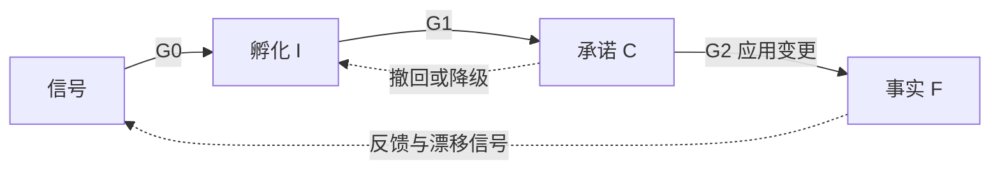

# 知识库成熟度模型

> 本篇定义知识的状态、视图、迁移门禁与权限。知识的组织方式见[知识库组织与维护](knowledge-organization.md)，操作步骤见[需求变更流程](change-workflow.md)。
> 门禁条件以本篇为准，流程篇引用条件，不另行维护一套准入标准。

## 1. 为什么要区分成熟度

系统知识库里同时存在已上线的事实、已确认待交付的需求、未确认的想法。混在一起时，Agent 容易把“有人提过”或“将来要做”当成“现在就是这样”。

本模型按确定性与交付状态区分三类内容：越接近事实，一致性要求越严格，写入权限越收紧。

- 未确认的想法允许矛盾，但必须保留来源并标明与现状和计划的关系。
- 已承诺的内容是对事实的变更，不复制一份全量未来知识库。
- 上线并核验后，应用变更更新生效知识，保留历史与追溯。
- **自动形成提案不等于自动承诺需求。** Agent 可以自主写孵化内容，业务承诺须人确认。

## 2. I/C/F 三层定义

| | **孵化层 I：Could-Be** | **承诺层 C：To-Be** | **事实层 F：As-Is** |
|---|---|---|---|
| 含义 | 未对齐、未确认的想法、诉求与愿景 | 已对齐、已确认、待交付的变更 | 已实现并上线的特性 |
| 内容 | 入孵信号、诉求簇、构想、提案草稿、长期愿景 | 变更集 Δ、验收示例、目标版本、实现设计 | 生效的术语、规则、流程、实现映射、配置、SOP |
| 一致性要求 | 弱，允许互相矛盾，但标明与 F/C 的关系 | 强，叠加到事实后的未来视图自洽 | 最强，自身自洽并与线上实现一致 |
| 证据 | 群消息、反馈、工单、会议、数据、战略 | 用户或业务 owner 确认、评审结论、ADR | 线上实现、发布记录、核验结果 |
| 写入方 | Agent 自主写入 | Agent 起草，人确认后写入 | 发布事件驱动晋升；人确认的校准 |
| 变化频率 | 高，随信号变化 | 中，随迭代变化 | 按生效版本变化 |
| 可怎样引用 | 线索或假设，不是事实 | 计划，不是现状 | 当前事实 |

[知识单元](knowledge-organization.md#knowledge-unit)和[变更集](change-workflow.md#change-set)不是同一种对象：F 维护生效知识，C 维护尚未交付的 Δ，I 保留尚未承诺的提案与证据。

## 3. 视图与结构的关系

### 3.1 三种视图

| 视图 | 组成 | 回答的问题 |
|---|---|---|
| 现状视图 | F | 系统现在是什么样子 |
| 未来视图 | F ⊕ C | 按已承诺变更交付后将是什么样子 |
| 探索视图 | F ⊕ C ＋ I，I 显式标为假设 | 还有哪些可能性与未满足诉求 |

⊕ 是按交付顺序应用补丁，不是简单相加。补丁可以新增、修改或废弃知识。`F ⊕ C(≤R)` 表示目标版本 R 及之前的承诺变更按序交付后的视图。

承诺层已经表达相对于事实基线的变化，任务拆解把**尚未交付的 Δ**映射到实现层，不再计算 `C − F`。

### 3.2 与 L0–L3 正交

[L0–L3](knowledge-organization.md#structure-layers)回答内容属于哪类知识；成熟度回答这份内容处于什么状态、可以怎样使用。

| | L0 语言 | L1 领域 | L2 映射 | L3 实现 |
|---|---|---|---|---|
| 孵化层 | 候选术语 | 问题陈述、规则草图 | 通常没有 | 通常没有 |
| 承诺层 | 术语变更 | 规则 Δ 与验收示例 | 计划映射 | 设计方案、改动点 |
| 事实层 | 生效术语 | 生效规则与流程 | 已核验映射 | 生效实现描述 |

越接近事实，越需要从问题空间延伸到解空间并补齐映射。该矩阵描述不同状态下的内容形态，不表示把同一个知识单元复制三份；变更集可以跨多个结构层。

### 3.3 跨层不变量

1. **依赖向下**：F 的有效性不依赖 C/I 的未交付或未确认内容；C 不以 I 为已确认前提。来源追溯与内容依赖要区分。
2. **区分知识与变更**：F 保存生效知识版本，C 保存待交付 Δ。G2 通过后应用 Δ 更新 F，已交付变更退出待交付集合，保留变更记录与历史版本。
3. **补丁表达**：新增、修改、废弃均注明作用对象与变更内容，不复制全量原文后另行维护。
4. **基线锚定**：每个承诺项记录基于哪个事实版本。
5. **切片一致**：每个目标版本 R 对应的 `F ⊕ C(≤R)` 都应自洽，不只最终结果自洽。
6. **关系显式**：每个孵化项标明与 F/C 的新增、扩展、修改、冲突或重复关系。

## 4. 状态迁移与门禁

### 4.1 晋升条件

| 门禁 | 方向 | 必须满足的条件 | 决策者 |
|---|---|---|---|
| **G0 入孵** | 信号 → I | 来源可追溯；能识别诉求；完成[分诊](change-workflow.md#triage)，排除缺陷、咨询及待核验项；已去重或归并 | Agent 自动 |
| **G1 承诺** | I → C | ① 用户或业务 owner 明确确认；② 语言对齐、上下文定位；③ 规则原子化并附验收示例；④ `F ⊕ C ⊕ Δ` 通过[一致性校验](change-workflow.md#change-analysis)；⑤ 无阻塞性未决问题；⑥ 指定 owner 和目标版本 | 人裁决，Agent 准备材料 |
| **G2 事实** | C → F | ① 已上线且有发布记录；② 实现映射已建立；③ 验收示例在实现上成立；④ 写入生效时间 | 发布事件触发，Agent 核验，异常由人处理 |

G0/G1/G2 定义能否推进状态；证据、校验和回写动作按[变更流程](change-workflow.md)执行。门禁未通过时不得用改状态的方式绕过问题。

### 4.2 逆向、退出与异常

| 场景 | 合法处理 |
|---|---|
| 孵化项休眠 | 长期无新证据时衰减并休眠；新信号出现后唤醒 |
| 孵化项否决 | 保留理由作为反证，再次出现时关联；重新评估须有新证据 |
| 孵化项合并或转类 | 合并保留来源；发现属于缺陷或知识补全时重新分诊 |
| 承诺项撤回或降级 | 从未来视图移除该 Δ，重新校验依赖它的承诺项，再退回孵化或归档 |
| 承诺项变更 | 重新按 G1 做影响分析、校验与确认 |
| 事实下线 | 不直接删除；以收缩类需求重新走孵化、承诺、上线流程 |
| 事实漂移 | 先判定预期：知识正确则转缺陷；线上正确则校准事实，需人确认并留痕 |
| 待核验 | 只是分诊状态，不是第四个成熟度层；证据不足时补证后重新分诊，未收录不等于不支持 |

每次状态变化记录谁、何时、依据什么；不得将未经核验的结论当作事实。

事实基线变化后，其余承诺项必须重新校验前置假设、冲突和版本切片；这是 **rebase**，执行步骤见[事实回写](change-workflow.md#fact-update)。

## 5. 人机权限与状态标记

| 层 | Agent 权限 | 人的职责 |
|---|---|---|
| I | 采集、分诊、提炼、归并、评估和起草 | 抽查质量，设定愿景与优先级，否决 |
| C | 起草、校验、影响分析、rebase，不能自主作出承诺 | G1 确认、冲突裁决、边界重构决策 |
| F | 核验、检测漂移、提出校准建议，不能自主改写事实 | 确认校准、处理异常；正常晋升由发布事件驱动 |

“草稿、评审中”表示材料准备状态；“规划”表示已承诺但尚未生效；“生效”表示当前事实；“已废弃”保留历史而不作为当前规则。这些标记应与成熟度和门禁一致，不能仅靠修改标签完成晋升。

越接近事实，把关越严格；正常交付不必由人重复抄写知识，但发布驱动的晋升必须有核验证据。自动提案不能越过 G1，存在未决问题的规则不能直接成为生效事实。

## 6. Agent 按任务选用视图

| 任务 | 使用视图 | 引用要求 |
|---|---|---|
| 现状问答、排障、当前系统影响评估 | F | 只引用事实 |
| 新需求分析 | F ⊕ C，辅以 I | 与未来视图比对，参考相关诉求和否决记录 |
| 任务拆解 | 以 F 为事实基线，处理 C 中尚未交付的 Δ | 映射到 L2/L3，不把整个未来视图重做一遍 |
| 规划、路线图 | 探索视图 | I 内容标为未确认，C 内容标为计划 |
| 通用 | 按任务限定 | 附层级、ID 与出处；冲突和缺口上报，不自行补全 |

具体查阅路径见[知识组织](knowledge-organization.md)，维护节奏与度量见[持续治理](change-workflow.md#governance)。

### 反模式

把想法或计划当事实；复制全量 F 作为 C；未确认就承诺；未核验就晋升；承诺撤回不校验依赖；基线变化不 rebase；上线后不更新 F。

**小结：成熟度定义知识能否采信、如何引用和何时晋升，不替代知识结构，也不重复定义操作流程。**
